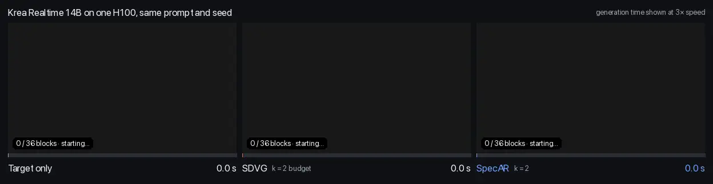
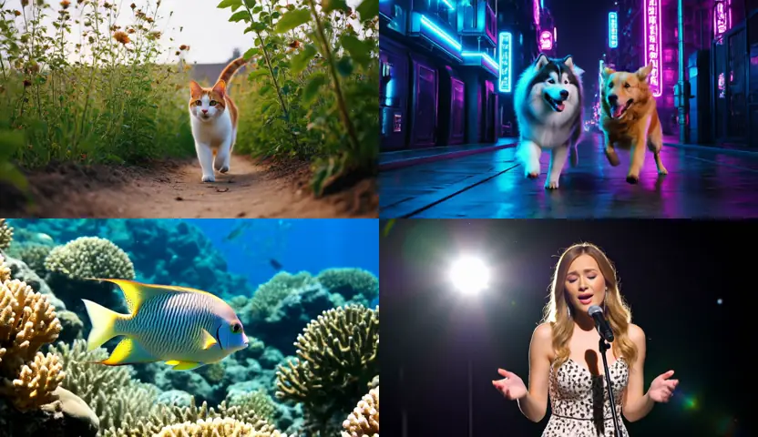

# SpecAR

SpecAR speeds up block-autoregressive video generation by letting a small drafter generate most blocks and the
large target generate k blocks spread evenly over the video. This repository runs SpecAR on two backbones:

| Backbone | Target | Drafter |
|---|---|---|
| `krea` | [Krea Realtime 14B](https://huggingface.co/krea/krea-realtime-video) | [Self-Forcing](https://github.com/guandeh17/Self-Forcing) 1.3B |
| `helios` | [Helios-Base 14B](https://huggingface.co/BestWishYsh/Helios-Base) | [Helios-Distilled 14B](https://huggingface.co/BestWishYsh/Helios-Distilled) |

<p align="center"></p>
<p align="center"><sub>Krea Realtime 14B on one H100, same prompt and seed. Each video plays as fast as its method generates it,
block by block; generation time is shown at 3&times; speed. SpecAR (k = 2) finishes in 32.8 s, 2.67&times; faster than
target-only generation (87.6 s); SDVG at the same target budget takes 56.8 s. Latencies from Table 1 of the paper.</sub></p>

Paper: *SpecAR: Distributed Target Blocks for Fast Autoregressive Video Generation*, Hudeifa Hassan, Statite.

Project page: [statite.ai/specar](https://statite.ai/specar) · Paper: [PDF](https://statite.ai/specar/specar.pdf)

## Quick start

Needs one NVIDIA data-centre GPU, a CUDA 12.8 driver and Python 3.11: Hopper (H100 80GB, H200 141GB) for both
backbones, or Blackwell (B200) for Krea Realtime. The install and the commands are the same on either. Nothing has
to be compiled: SpecAR picks the attention kernel for the GPU when it starts, FlashAttention 3 on Hopper (fetched
prebuilt from the Hugging Face kernel hub on first use) and FlashAttention 4 on Blackwell (installed with the
package). All weights are public.
On a shared cloud machine, log in to Hugging Face first (`hf auth login`, a free account is enough): anonymous
downloads from shared IPs are often rate-limited.

**Krea Realtime 14B** (about 50 GB download; a 26.6 s video generates in under a minute on an H100, after about 3 minutes of model loading)

```bash
git clone https://github.com/statite-ai/SpecAR && cd SpecAR
python3.11 -m venv .venv-krea && source .venv-krea/bin/activate
pip install ".[krea]"
specar download --backbone krea
specar generate --backbone krea --prompt "A papercraft coral reef full of colorful fish" --k 2 --out reef.mp4
```

**Helios 14B** (about 150 GB download for the two models on disk, about 66 GB of GPU memory while generating; a 74 s
video generates in under 5 minutes on an H100 at k = 2, after about 1 minute of model loading)

```bash
git clone https://github.com/statite-ai/SpecAR && cd SpecAR
python3.11 -m venv .venv-helios && source .venv-helios/bin/activate
pip install ".[helios]"
specar download --backbone helios
specar generate --backbone helios --prompt "A papercraft coral reef full of colorful fish" --k 2 --out reef.mp4
```

Each backbone pins the library versions its reference outputs were produced with, so keep one environment per
backbone.

## Choosing what to generate

```bash
specar generate --prompt "A spacecraft flying above Mars" --seconds 10 --k 2 --out mars.mp4
specar generate --example cat --out cat.mp4      # a curated prompt with its paper settings
specar examples                                  # list the curated prompts
```

- **Prompt:** `--prompt "..."` for your own text, or `--example NAME` for one of the ten curated prompts below.
- **Length:** `--seconds` gives the video length in seconds; it is rounded to whole blocks and the command prints the
  length it will actually generate. `--blocks` sets the exact block count instead. A Krea block is 12 frames
  (36 blocks = 426 frames, 26.6 s at 16 fps); a Helios block is a 33-frame chunk (36 chunks = 1185 frames, 74 s).
  **36 blocks is the tested length** (all results and reference latents); shorter videos also run. Longer
  videos need more GPU memory and have not been tested.
- **Target budget:** `--k` is the number of blocks the target generates (2 is the fastest setting in the paper, 7 the
  default); the drafter generates the rest. `k` cannot exceed the number of blocks. The target generates blocks
  `floor(j * blocks / k + 1/2)` for `j = 0..k-1`.
- **Output:** `--out` (default `specar.mp4`); `--seed` (default 42); `--weights` (default `weights`);
  `--save-latents` also writes the latents next to the video.
- **Execution (Krea):** `--attention auto|fa3|fa4|fa2` overrides the attention kernel (default `auto`; the
  environment variable `SPECAR_ATTENTION` does the same); `--steps` sets the denoising steps per block (default 5,
  the tested setting). The command prints the kernel it is using. The same prompt and seed give a different video on
  a different GPU family or attention kernel: the model is the same, but small numerical differences grow over the
  rollout.

### Curated prompts

All come from the paper's evaluation sets and use the paper's settings (seed, k = 7, 36 blocks). `--example` fills in
the backbone, prompt, seed and k; any flag you give yourself takes precedence.

| Name | Backbone | Seed | Prompt (start) |
|---|---|---|---|
| `mammoths` | krea | 42 | Several giant wooly mammoths approach treading through a sno… |
| `spaceman` | krea | 42 | A movie trailer featuring the adventures of the 30 year old… |
| `monster` | krea | 42 | Animated scene features a close-up of a short fluffy monster… |
| `reef` | krea | 42 | A gorgeously rendered papercraft world of a coral reef, rife… |
| `cat` | krea | 42 | A white and orange tabby cat is seen happily darting through… |
| `dogs` | krea | 42 | A Samoyed and a Golden Retriever dog are playfully romping t… |
| `fish` | krea | 42 | A tropical fish swimming in ocean reefs |
| `singer` | krea | 42 | A woman singing and standing in a concert stage with a brigh… |
| `helios-fish` | helios | 115059 | A vibrant tropical fish swimming gracefully among colorful c… |
| `dandelion` | helios | 115081 | A hyper-realistic macro photograph capturing the intricate d… |

<p align="center"></p>
<p align="center"><sub>SpecAR on Krea Realtime 14B at k = 7: the first 8 s of four 26.6 s videos (<code>specar generate --example cat</code>,
<code>dogs</code>, <code>fish</code>, <code>singer</code>).</sub></p>

`cat`, `dogs`, `fish` and `singer` are the videos on the project page. `mammoths`, `spaceman`, `monster`, `reef`,
`helios-fish` and `dandelion` have reference latents in `specar-benchmark`, so they reproduce bit for bit.

From Python:

```python
from specar.model_krea import Models, SpecARSession
from specar.schedule import uniform_k

models = Models("weights")
session = SpecARSession(models, "A papercraft coral reef", seed=42, num_blocks=36, anchors=uniform_k(7, 36))
latents = session.generate()
```

```python
from specar.model_helios import HeliosSpecAR
from specar.schedule import uniform_k

model = HeliosSpecAR("weights-helios", prompts=["A papercraft coral reef"])
latents, frames, chunk_seconds = model.generate("A papercraft coral reef", uniform_k(7, 36), num_chunks=36, seed=42)
```

## Check your setup

```bash
specar-benchmark --backbone krea --weights weights                     # k = 2, 7, 9; four prompts
specar-benchmark --backbone helios --weights weights-helios            # k = 7; two prompts, about 11 min each
```

The benchmark prints the generation time of each video and, on a Hopper GPU with FlashAttention 3 and 5 steps,
compares its latents bit for bit with the reference latents behind the paper's results. A mismatch there usually
means different library versions. On other GPUs and attention kernels it reports times and latent hashes without a
verdict. `--json` records the GPU, library versions, attention kernel and settings with the results. The times it prints are generation time only; the latencies in the paper also include session setup and
frame decoding.

## Citation

```bibtex
@misc{hassan2026specar,
  title  = {SpecAR: Distributed Target Blocks for Fast Autoregressive Video Generation},
  author = {Hassan, Hudeifa},
  year   = {2026},
  note   = {Preprint},
  url    = {https://statite.ai/specar}
}
```

## License

SpecAR's own code (`specar/schedule.py`, `specar/attention.py`, `specar/cli.py`, `specar/benchmark.py`,
`specar/model_helios.py`) is
Apache-2.0 (`LICENSE`). `specar/_vendor/helios/` is copied unchanged from
[Helios](https://github.com/PKU-YuanGroup/Helios) (Apache-2.0, `specar/_vendor/helios/LICENSE.txt`).

The Krea Realtime backend (`specar/model_krea.py`) is adapted from Krea's code, and `specar/_vendor/krea/` is copied
from it; both are CC BY-NC-SA 4.0 (`specar/_vendor/krea/LICENSE.md`), which allows non-commercial use only. See
`specar/_vendor/krea/NOTICE.md` for the source commit and the one change made.

Model weights carry their own licenses on Hugging Face.
